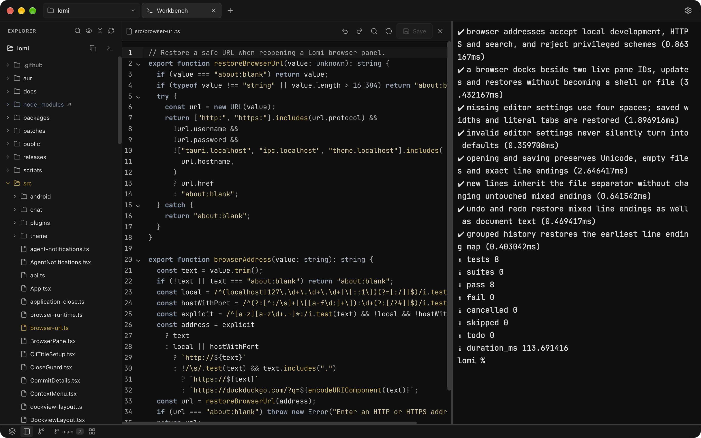
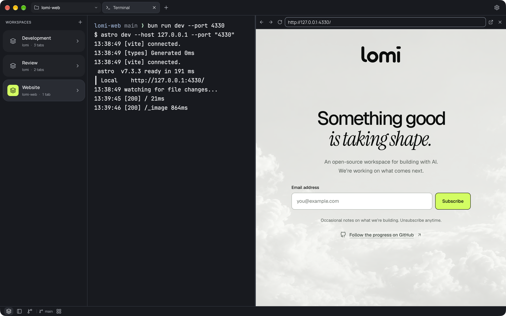
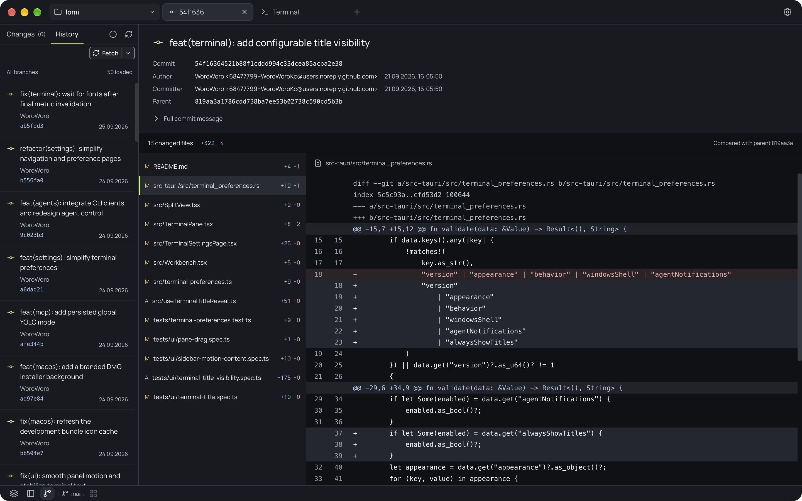
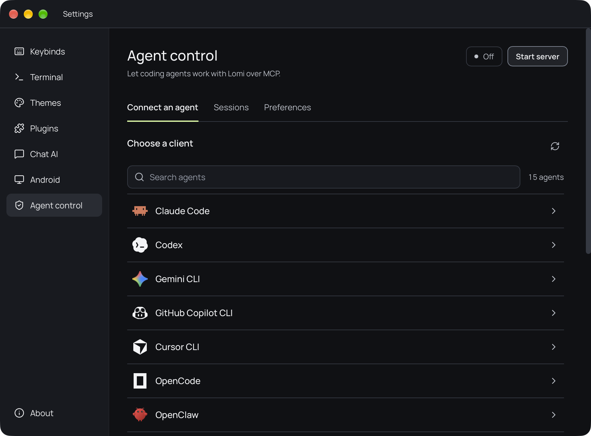
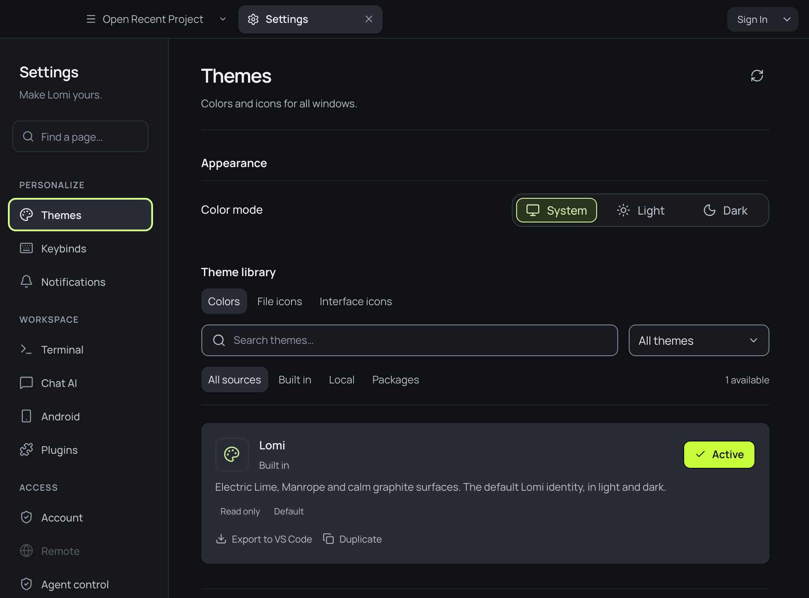

<div align="center">
  
  <h1>Lomi</h1>
  <p><strong>The open-source desktop workspace for terminal-driven development.</strong></p>
  <p>Native terminals, a code editor, browser previews, Git and your coding agents in one window.</p>
  <p>
    <a href="https://github.com/lomi-dev/lomi/releases/latest"></a>
    <a href="https://github.com/lomi-dev/lomi/releases"></a>
    
    <a href="LICENSE"></a>
  </p>
  <p>
    <a href="https://lomi.dev">Website</a> ·
    <a href="https://github.com/lomi-dev/lomi/releases/latest">Download</a> ·
    <a href="#features">Features</a> ·
    <a href="https://docs.lomi.dev">Docs</a> ·
    <a href="#build-from-source">Build from source</a> ·
    <a href="https://github.com/lomi-dev/lomi/issues">Report an issue</a>
  </p>
</div>

<picture>
  <source media="(prefers-color-scheme: light)" srcset="docs/images/workbench-light.png" />
  
</picture>

## What is Lomi?

Lomi is a local development workspace for macOS, Linux and Windows. Open a
project folder and arrange real shells, editors, browser previews, Git views and
AI chats side by side. Keep separate workspaces for separate tasks; their
terminals keep running in the background while you switch.

Run Claude Code, Codex, Gemini CLI or any other CLI agent in a Lomi terminal,
and let it work with your workspace over MCP once you approve it. Lomi is built
with Tauri 2 and Rust and uses the system webview. There is no account and no
telemetry: API keys stay in your system credential store, and history stays on
your device.

## Screenshots

<table>
  <tr>
    <td width="50%" align="center"><br /><sub>Preview a local dev server next to the terminal that runs it</sub></td>
    <td width="50%" align="center"><br /><sub>Browse history, inspect commits and review diffs</sub></td>
  </tr>
  <tr>
    <td align="center"><br /><sub>Connect coding agents to Lomi over MCP</sub></td>
    <td align="center"><br /><sub>Built-in theme, light and dark modes, VS Code import</sub></td>
  </tr>
</table>

## Features

- **Workspaces:** separate tasks into named workspaces with flexible tabs and
  split layouts.
- **Native terminals:** Bash, Zsh, Fish, PowerShell, Command Prompt and WSL,
  with output streaming across tabs and workspaces.
- **Code and files:** syntax highlighting, shared editor buffers, project
  search, and Markdown, SVG and image previews.
- **Git:** stage, commit, sync, browse history and review diffs in one place.
- **Browser and Android:** preview local apps in browser panels or embedded
  virtual Android phones. Android setup requires macOS with Apple Silicon.
- **Coding agents:** CLI integrations on macOS and Linux, plus MCP workspace
  control with approved permissions on macOS with Apple Silicon.
- **Chat AI:** use your own provider API keys, keep local conversation history
  and export chats.
- **Customization:** light and dark themes, VS Code theme imports, configurable
  shortcuts and trusted local plugins.

## Install

Download the package for your platform from the
[latest release](https://github.com/lomi-dev/lomi/releases/latest).

See the [installation guide](https://docs.lomi.dev/overview/installation/) for
platform requirements, first launch and updates.

On Linux, remembering account sessions and AI API keys requires an available
Secret Service provider, such as GNOME Keyring or KDE Wallet, with an unlocked
default collection in your desktop session. If the credential store cannot save
an account session, Lomi can keep the sign-in in memory until you quit and shows
that it was not remembered. Configure your desktop's keyring to retain sign-in
across restarts; installing the app alone does not configure that service.

On Arch Linux with Hyprland, one option is to install `gnome-keyring` and
`seahorse`, then use Seahorse (Passwords and Keys) to create or unlock a
password-protected keyring and set it as the default. See the
[ArchWiki GNOME Keyring guide](https://wiki.archlinux.org/title/GNOME/Keyring)
for desktop session startup and automatic unlocking. You can also turn off
**Remember me on this device** in Account settings to sign in without a keyring.

## Documentation

Visit **[docs.lomi.dev](https://docs.lomi.dev)** for installation, setup, themes
and plugin development guides, available in English and Polish.

## Build from source

Follow the [source setup guide](https://docs.lomi.dev/overview/installation/#run-from-source)
for platform prerequisites. Node.js and pnpm versions are defined in
[package.json](package.json).

```sh
git clone https://github.com/lomi-dev/lomi.git
cd lomi
pnpm install --frozen-lockfile
pnpm tauri dev
```

See [AGENTS.md](AGENTS.md) for the source layout, development commands and
validation requirements.

## Contributing

Issues and pull requests are welcome. Read [AGENTS.md](AGENTS.md) before
changing code, keep changes focused, and use
`type(scope): short imperative summary` for commit and pull request titles.
Fill in the [pull request template](.github/pull_request_template.md) with the
checks you actually ran. Do not add AI co-author attribution.

## License

Copyright 2026 Maciej Kolerski. Licensed under [Apache 2.0](LICENSE).

The default Lomi theme follows the Lomi Brandbook and Design System. Bundled
fonts, including Manrope and JetBrains Mono, keep their own licenses in
[public/fonts](public/fonts).
